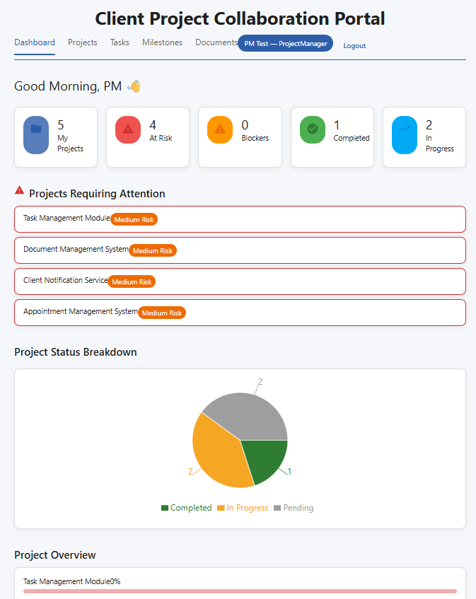
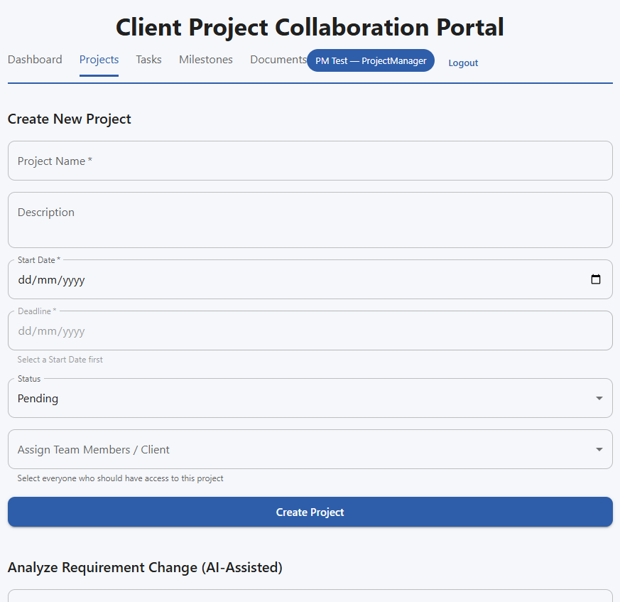
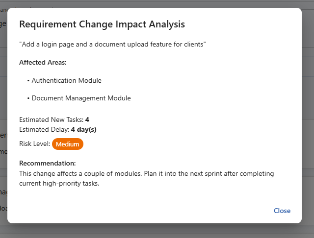
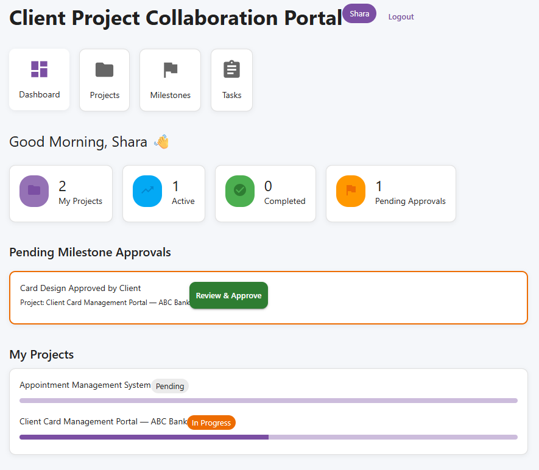

# Client Project Collaboration Portal

A role-based web application where a Project Manager runs projects with a team, and the client can follow progress, review deliverables and approve milestones, all in one place.

Every new account must be approved by an Admin before it can log in.

## Screenshots

**Project Manager dashboard: project risk and progress at a glance**



**Creating a project and assigning the team**



**Requirement change impact analysis (rule-based)**



**Client dashboard: pending milestone approvals**



## Roles and features

Each role gets its own layout: a sidebar for Admin, top tabs for Project Manager, a bottom navigation bar for Team Member, and card-style navigation for Client.

### Admin
Runs the platform, not the projects.
- Approve or reject new registrations
- Change user roles and activate or deactivate accounts (an Admin cannot deactivate themselves)
- Monitor all projects in a read-only table (project manager, client, status, progress)
- View system statistics and charts, and export a project report to Excel
- Edit their own profile

Creating and editing projects, tasks, milestones and documents is restricted to the Project Manager in the backend, not only hidden in the interface.

### Project Manager
Runs the projects.
- Create projects, assign team members and a client, and delete projects
- Create tasks, assign them to team members, and delete them
- Create milestones, optionally attach a deliverable file for the client to review, and delete them
- Upload documents
- Resolve blockers reported by team members
- Use the two analysis tools described below
- Dashboard with at-risk projects, open blockers and progress per project

### Team Member
Does the assigned work.
- See only the projects and tasks they belong to
- Update the status and progress of their own tasks (the two stay in sync)
- Report a blocker on a task, and clear it later
- Comment on tasks
- Upload documents linked to one of their projects and one of their assigned tasks
- View milestones (read-only)
- Dashboard with overdue, today's and upcoming tasks

### Client
Reviews the work and approves milestones.
- See only their own projects, with progress
- View tasks (read-only) and comment on them
- Review a completed milestone, including the attached deliverable file, then approve it
- Cannot upload documents (blocked in the backend as well)

## Analysis tools (rule-based)

The portal includes two decision-support tools for Project Managers. They are **rule-based logic written in C#**. They do not use machine learning or any external AI service.

**Deadline Risk Prediction**
Looks at overdue tasks, the share of tasks completed, milestones waiting for client approval, and the days left until the deadline. It returns a risk score from 0 to 100, a risk level (Low, Medium or High), the reasons behind it, and recommendations. The Project Manager dashboard runs it for every project to flag the risky ones.

**Requirement Change Impact Analysis**
The Project Manager types a new or changed requirement in plain text. The system matches keywords (such as "login" or "document") to the modules of the portal and returns the affected areas, an estimated number of new tasks, an estimated delay in days, a risk level and a recommendation.

## Security and validation

- Passwords are hashed with BCrypt
- Login uses JWT tokens
- Role permissions are enforced in the backend API
- Project, task and milestone creation have date rules (no past dates, and the deadline must be after the start date)
- Deleting a project, task or milestone asks for confirmation first

## Tech stack

**Frontend**
- React 19 with Vite
- Material UI (MUI)
- React Router
- Axios
- Recharts for charts
- SheetJS (xlsx) for Excel export

**Backend**
- ASP.NET Core Web API (.NET 10)
- Entity Framework Core with PostgreSQL (Npgsql)
- JWT Bearer authentication
- BCrypt.Net for password hashing

## Getting started

### What you need
- .NET 10 SDK
- Node.js (LTS)
- PostgreSQL

### 1. Backend
1. Go to `backend/ClientPortalAPI`
2. Copy `appsettings.example.json` to a new file named `appsettings.json`
3. In `appsettings.json`, set your own PostgreSQL connection details and a long random value for `Jwt:Key`
4. Create the database tables:
   ```
   dotnet ef database update
   ```
5. Start the API:
   ```
   dotnet run
   ```
   The API listens on `http://localhost:5256`.

`appsettings.json` is listed in `.gitignore`, so your real passwords and keys are never committed.

### 2. Frontend
1. Go to `frontend`
2. Install packages and start the app:
   ```
   npm install
   npm run dev
   ```
3. Open `http://localhost:5173`

## Project structure

```
backend/ClientPortalAPI   ASP.NET Core API (controllers, models, migrations)
frontend                  React application (pages, theme, routing)
```

## Author

GitHub: [@TasnuvaEsha-2002](https://github.com/TasnuvaEsha-2002)

